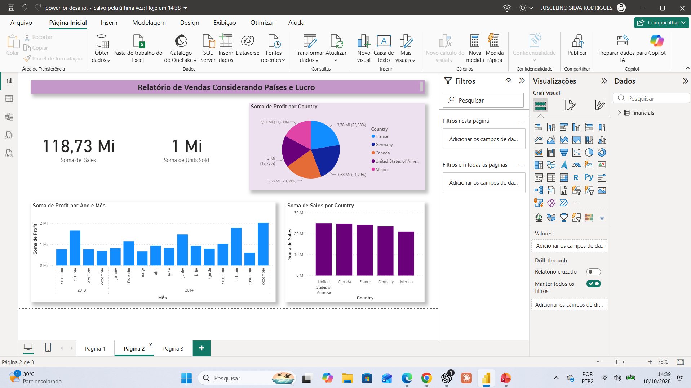
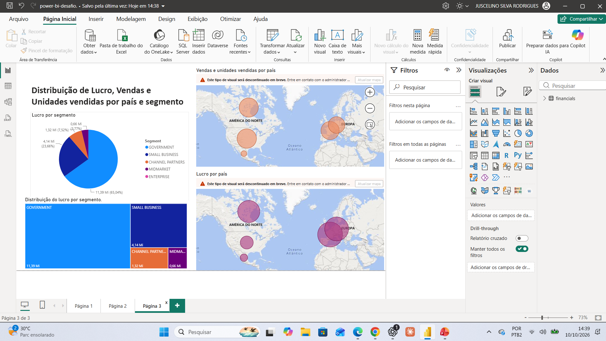
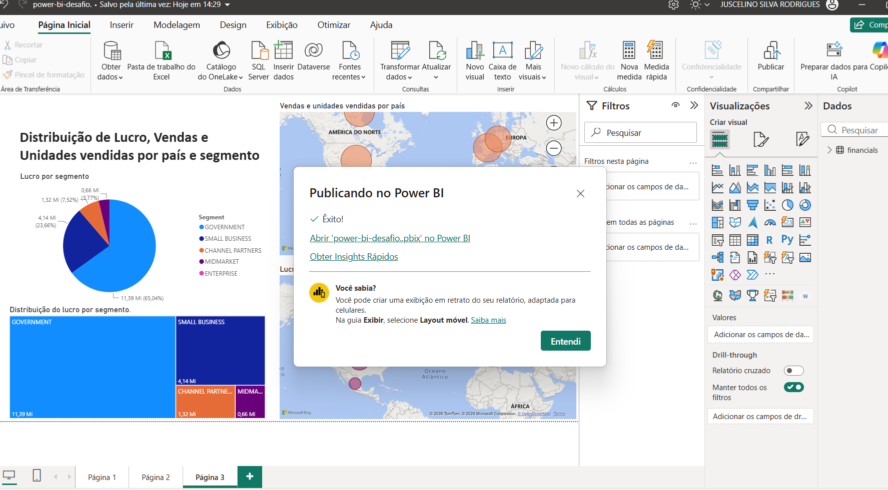
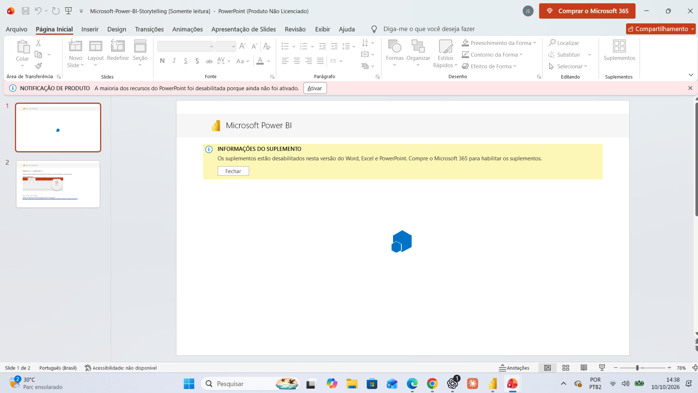

# Relatório de vendas com Power BI

Desafio da formação de análise de dados da DIO, utilizando a base Financial Sample e o relatório de referência de [Juliana Zanelatto](https://github.com/julianazanelatto/power_bi_analyst).

## Objetivo

Praticar a configuração de visuais, agregações, títulos e dicas de ferramentas em um relatório de três páginas.

## Origem e adaptações

O projeto partiu de `sample_financial.pbix`, disponibilizado pela professora. As páginas e visuais já existentes foram usados como referência; não são apresentados como criação integral do autor. Na cópia do desafio foram mantidas as três primeiras páginas, conferidos os campos da terceira página, habilitados os mapas e ajustados os títulos para português.

## Visuais da terceira página

| Visual | Configuração conferida |
|---|---|
| Vendas e unidades vendidas por país | Country em localização, soma de Sales no tamanho das bolhas e soma de Units Sold nas dicas de ferramentas |
| Lucro por país | Country em localização e soma de Profit no tamanho das bolhas |
| Lucro por segmento | Segment na legenda e soma de Profit nos valores |
| Distribuição do lucro por segmento | Treemap adicional com segmento e lucro |

Sales significa vendas; Units Sold, unidades vendidas; Profit, lucro; Country, país; Segment, segmento. Tooltip é a dica exibida ao passar o mouse sobre o visual.

## Arquivos e publicação

- [Projeto editável do Power BI](relatorio-vendas.pbix)
- [Dados Financial Sample do material original](../../M%C3%B3dulo%201/Primeiros%20passos%20com%20Power%20BI/Financial%20Sample.xlsx)
- [Relatório publicado no Power BI](https://app.powerbi.com/groups/me/reports/d9c2f421-168b-4f4f-b4b3-117724ff2d29/ReportSectionfec5356641e0bc8aa333?experience=power-bi)

A publicação foi confirmada pela mensagem de êxito no Power BI Desktop. O link do serviço pode exigir autenticação e permissão; não representa publicação pública na Web. Para inspecionar o projeto, baixe o arquivo PBIX e abra no Power BI Desktop. Mapas precisam estar habilitados nas opções de segurança para renderizar.

## Evidências

A captura mais recente da terceira página exibe um aviso de futura descontinuação do tipo de mapa utilizado. Os mapas estão renderizando na captura; uma atualização do visual poderá ser necessária. Dois dos prints enviados mostram o mesmo conteúdo da terceira página, por isso foi incluída uma única captura dessa tela. A captura da primeira página ainda não foi adicionada.

## Limitação do PowerPoint

A integração interativa foi tentada, mas o PowerPoint instalado estava sem ativação e com suplementos desabilitados. Portanto, não foi concluída a integração com PowerPoint. O arquivo PBIX foi preservado como alternativa, acompanhado do link publicado.

## Aprendizados

- Distinção entre abrir um projeto PBIX e importar dados de uma planilha.
- Conferência das agregações e dos campos dos mapas e da pizza.
- Uso de títulos claros e revisão das dicas de ferramentas.
- Publicação no workspace pessoal e identificação de limitações de acesso e licença.

Os dados são da amostra didática; não representam resultados comerciais pessoais.
